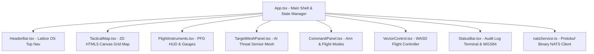

# Anduril Lattice Software UI Architecture Guide

This document explains the technical architecture, design system, communication pipeline, and component structure of the **Anduril Lattice Operating System Interface** built for the drone simulator frontend.

---

## 1. Tactical Design System & Styling Tokens

The user interface follows the high-density tactical command and control (C2) aesthetic modeled after modern defense technology software.

### Color Palette (`tailwind.config.js` & `index.css`)
- **Base Surface (`#070707` Obsidian)**: Deep dark background with a 48px square subtle grid texture.
- **Card Panel (`#0e0e0e`)**: Dark carbon containers bordered by `#2a2a2a` lines.
- **Lattice Amber (`#c4a574` Brass Gold)**: Primary tactical highlight color used for active states, HUD reticles, crosshairs, and key indicators.
- **Tactical Green (`#7d9a6a`)**: Status OK, GNSS satellite fix, and nominal battery level.
- **Alert Red (`#b85c4a`)**: Armed state warnings, critical alerts, disarm triggers, and high-threat targets.
- **Warm Parchment (`#e8e4d9`)**: Monospaced typography with wide letter tracking (`tracking-[0.22em]`).

### Tactical Panel Styling Utilities
- **Panel Corner Ticks (`.panel-tick` and `.panel-tick-bottom`)**: Renders sharp 1.5px brass bracket accents on panel corners.
- **Tactical Scrollbars**: Narrow 5px scrollbars styled in dark obsidian and brass highlights.

---

## 2. Component Architecture



### Component Details

#### [HeaderBar.tsx](file:///Users/ayssar.mb/Desktop/dev/projects/drone-sim/frontend/src/components/HeaderBar.tsx)
- Top bar displaying `LATTICE OS C2 TACTICAL CONSOLE`.
- **Asset Switcher**: Toggle between `DRONE-01 (ACTIVE)` and `DRONE-02 (STANDBY)`.
- **View Switcher**: Quick toggle between `SPLIT C2`, `TACTICAL MAP`, and `PFD HUD`.
- **Real-Time Telemetry Badges**: NATS Link State (10 Hz), Safety Arm Badge (`ARMED` / `SAFE`), Flight Mode, Battery %, Satellites count, and UTC system clock.

#### [TacticalMap.tsx](file:///Users/ayssar.mb/Desktop/dev/projects/drone-sim/frontend/src/components/TacticalMap.tsx)
- High-performance HTML5 2D Canvas tactical map rendering:
  - **WGS84 Reference Grid**: Geodetic coordinate lines.
  - **Asset Marker & FOV Cone**: Drone position chevron with a radial gradient sensor field-of-view cone oriented by `headingDeg`.
  - **Breadcrumb Trail**: Historical path lines recording recent flight coordinates.
  - **Radar Distance Rings**: Concentric circles at 50m, 100m, and 200m.
  - **AI Target Mesh Nodes**: Detections (`TRK-4091`, `TRK-4092`, `TRK-4093`) with threat level color coding, distance/bearing labels, and target lock circles.
  - **Interactive Controls**: Zoom (+/-), Recenter on asset, Toggle Grid, Toggle Target Mesh.

#### [FlightInstruments.tsx](file:///Users/ayssar.mb/Desktop/dev/projects/drone-sim/frontend/src/components/FlightInstruments.tsx)
- **Primary Flight Display (PFD) HUD**:
  - **Artificial Horizon Sphere**: Rotating gradient sphere (sky/ground) with roll index and pitch ladder marks (+/- 10°, +/- 20°).
  - **Compass Rose Gauge**: 360° rotating direction rose.
  - **Altitude Tape**: Vertical tape displaying meters AMSL.
  - **Attitude Metrics Grid**: Live Roll, Pitch, Yaw, Heading, Altitude, and Satellite Fix lock meters.

#### [TargetMeshPanel.tsx](file:///Users/ayssar.mb/Desktop/dev/projects/drone-sim/frontend/src/components/TargetMeshPanel.tsx)
- AI Target Mesh sensor contact feed.
- Shows track ID, classification (`VEHICLE`, `AIRCRAFT`, `SENSOR`), threat level (`HIGH`, `MEDIUM`, `LOW`), confidence %, distance, and bearing.
- Provides **INTERCEPT** and **TRACK ORBIT** action triggers.

#### [CommandPanel.tsx](file:///Users/ayssar.mb/Desktop/dev/projects/drone-sim/frontend/src/components/CommandPanel.tsx)
- **Safety ARM / DISARM Trigger**: Two-step arming confirmation modal to prevent accidental propulsion activation.
- **Flight Commands**: `TAKEOFF`, `LAND`, `RTL`, `HOLD`, `OFFBOARD`.

#### [VectorControl.tsx](file:///Users/ayssar.mb/Desktop/dev/projects/drone-sim/frontend/src/components/VectorControl.tsx)
- **3x3 Tactical D-Pad & WASD Hotkeys**:
  - `W` / `S`: Pitch forward / backward (`vx`)
  - `A` / `D`: Roll left / right (`vy`)
  - `Q` / `E`: Yaw rotate left / right (`yawRate`)
  - `R` / `F`: Climb / descend (`vz`)
  - `Space`: Emergency stop / hover
- **Cruise Speed & Target Altitude Sliders**: Adjustable with fast presets (2m/s, 5m/s, 10m/s / 2m, 5m, 10m, 20m).

#### [StatusBar.tsx](file:///Users/ayssar.mb/Desktop/dev/projects/drone-sim/frontend/src/components/StatusBar.tsx)
- Terminal execution log displaying timestamped command status tags (`RECEIVED`, `ACCEPTED`, `EXECUTED`, `FAILED`).
- WGS84 Geodetic coordinates (`LAT`, `LON`, `ALT`) and NATS 10 Hz sync indicator.

---

## 3. Communication Protocol & Protobuf Binary Pipeline

Communication between the frontend React application and the ROS 2 C++ bridge node (`px4_nats_bridge_node`) uses **NATS WebSockets** (`nats.ws` on port `9222`) transmitting **Protobuf binary** payloads:

### Binary Encoding & Decoding (`natsService.ts`)

```
+-------------------+           NATS WebSocket (9222)           +-----------------------+
|  React Frontend   | <---------------------------------------> | ROS 2 C++ Bridge Node |
|  (@bufbuild/pb)   |  drone.<id>.telemetry (Protobuf Binary)   | (px4_nats_bridge_node)|
+-------------------+  drone.<id>.command (Protobuf Binary)     +-----------------------+
```

1. **Incoming Telemetry (`drone.<drone_id>.telemetry`)**:
   - Parsed using `@bufbuild/protobuf` `BinaryReader`.
   - Decodes fields: `drone_id` (tag 1), `timestamp_ms` (tag 2), `connected` (tag 3), `armed` (tag 4), `flight_mode` (tag 5), `latitude` (tag 6), `longitude` (tag 7), `altitude_m` (tag 8), `roll` (tag 9), `pitch` (tag 10), `yaw` (tag 11), `battery_percentage` (tag 12), `gps_available` (tag 13), `satellites_visible` (tag 14), `heading_deg` (tag 15).

2. **Outgoing Commands (`drone.<drone_id>.command`)**:
   - Encoded using `@bufbuild/protobuf` `BinaryWriter` into `drone::v1::DroneCommand` binary wire format.
   - Encodes fields: `request_id` (tag 1), `drone_id` (tag 2), `timestamp_ms` (tag 3), `command` enum (tag 4), `takeoff` submessage (tag 5), `velocity` submessage (tag 6).

3. **Dual Telemetry Synchronization**:
   - **Local Kinematic Loop (20 Hz)**: Integrates instantaneous position, altitude, attitude, and heading changes when velocity controls are activated.
   - **NATS Telemetry Stream (10 Hz)**: Live C++ ROS 2 telemetry broadcasts override and synchronize exact PX4 SITL physics coordinates seamlessly.

---

## 4. Layout View Modes

The UI supports 3 primary view configurations:
1. **`SPLIT C2` (Default)**: Multi-column view combining Commands, Target Mesh, 2D Tactical Map, PFD HUD, and Vector Controls.
2. **`TACTICAL MAP`**: Maximized 2D Tactical Map canvas taking the main viewport.
3. **`PFD HUD`**: Maximized Primary Flight Display HUD with enlarged attitude sphere and compass rose.
